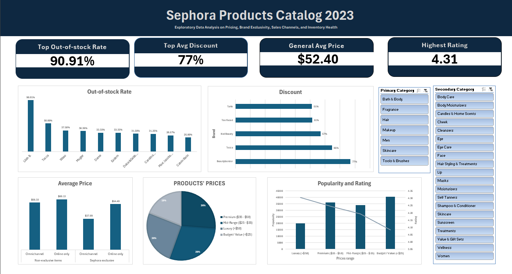

# Excel Sephora Dashboard

Interactive Excel dashboard for Sephora catalog in 2023.

## Introduction

This Sephora Catalog dashboard was created to explore product categories, regular and discount prices, brand popularity, the impact of different characteristics on price, and selling channels.

### Questions to Analyze

1. **What is the stockout rate (%) by primary category and brand?**
2. **What discount percentage is typically given?**
3. **Do Sephora's exclusive products achieve an average price and higher popularity than non-exclusive products?**
4. **Is there a correlation between the price of a product and its average rating?**

### Excel Skills Used
The following Excel skills were utilized for analysis:

- 📊 **Pivot Tables**
- 📈 **Pivot Charts**
- 🧮 **DAX (Data Analysis Expressions)**
- 🔍 **Power Query**
- 💪 **Power Pivot**

### Sephora Products Dataset
The dataset used for this project contains real-world beauty products information (over 8,000) from the Sephora online store in March 2023. The dataset is available via Kanggle web site.

It includes detailed information on:
- **Categories**
- **Regular and discount prices**
- **Brands**
- **Popularity and Rating**
- **Selling channels**
- **Others**

## 1️⃣ What is the stockout rate (%) by primary category and brand?
-  Excel Feactures
-  Design Choice
-  Data Organization
-  Insights Gained:

  

